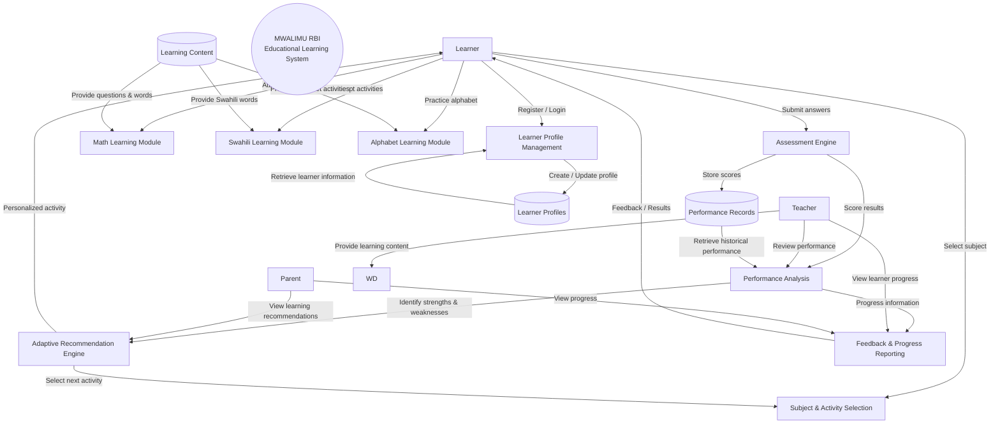

# MWALIMU RULE-BASED INTELLIGENCE LEARNING SYSTEM
## Sytem Context
'''mermaid
flowchart ID
%% ACTORS
L[Learner]
T[Teacher]
P[Parent]
%% MAIN SYSTEM
RBI((MWALIMU RBI Educational learning system))
%% PRIMARY SYSTEM FUNCTIONS
LP[Leaner_profile_management]
SA[Subject_&_Activity_selection]
MA[Math_Learning_Module]
SW[Swahili_learning_module]
AL[Alphabet_Learning_module]
AE[Assessment_Engine]
PA[Performance_Analysis]
AR[Adaptive_recommendation_engine]
FBR[Feedback_&_Progress_Report]
%% DATA STORES
LD[Learner_profiles]
PD[Performance_records]
LC[Learning_context]
%% LEARNER INTERACTIONS
L--->|Register/Sign up|LP
L--->|Select Subject|SA
L--->|Attempt Quizes|MA
L--->|Attempt Quizes|SW
L--->|Attempt Quizes|AL
L--->|Submit answers|AE
AE--->|Grade results|PA
PA--->|Asses areas of strength and weakness|AR
AR--->|Select new activity|SA
PA--->|Progess tracking|FBR
FBR--->|Results|L
%% TEACHERS INTERACTION
T--->|View learner progress|FBR
T--->|Review performance|PA
T--->|View learning progress|AR
%% PARENT INTERACTION
P--->|View progress|FBR
P--->|View learning recommendations|AR
%% PROFILE DATA
LP--->|Create/Update profile|LD
LD--->|Retrieve learner's information|LP
%% LEARNING CONTENT
LC--->|Provide qestions and words|MA
LC--->|Provide Swahili words|SW
LC--->|Provide alphabet quizes|AL
%% PERFORMANCE DATA
AE--->|Store Score|PD
PD--->|Retrieve historical performance|PA
%% ADAPTIVE LOOP
AR--->|Personal activity|L
'''
# System Context

